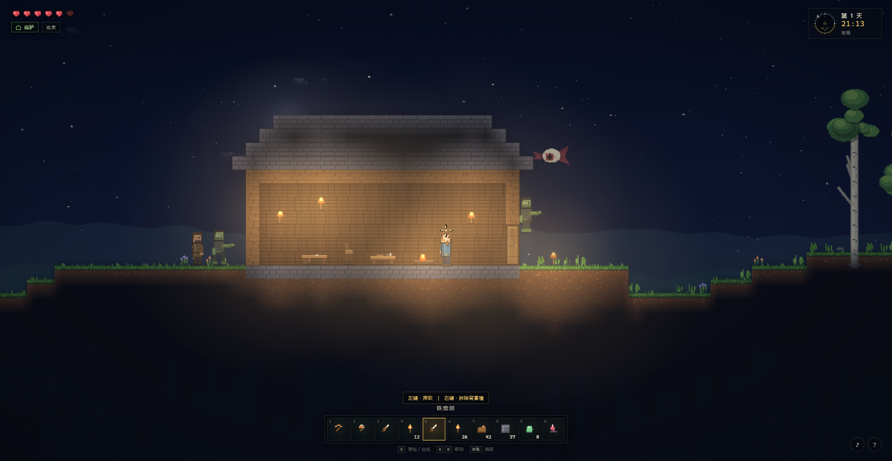

# 泰拉边境 · Terra Frontier

一款 **完全离线、零依赖** 的 2D 侧视像素沙盒生存游戏。灵感来自《泰拉瑞亚》：随机生成世界、挖掘建造、合成装备，在昼夜交替与夜晚怪物中活下去。



## 开始游戏

1. 双击 `index.html`（推荐 Chrome / Edge）。
2. 或双击 `启动游戏.bat`。
3. 点击「创建新世界」。可以在标题页填写世界种子，留空则随机生成。

> 建议使用桌面浏览器、键盘和鼠标。首次点击页面后音频才会启动。

## 操作

| 按键 | 功能 |
| --- | --- |
| `A` / `D` | 左右移动 |
| `空格` / `W` | 跳跃（按住跳得更高） |
| `S` + `空格` | 从木平台向下穿过 |
| 鼠标左键 | 挖掘 / 砍树 / 攻击 / 放置方块、墙壁与家具 / 使用物品 |
| 鼠标右键 | 开关门、使用工作台、拆除背景墙、与向导交谈 |
| `1` – `0` / 滚轮 | 切换快捷栏 |
| `E` / `I` | 打开背包与合成 |
| `Esc` | 暂停 / 关闭面板 |
| `M` | 静音 / 恢复声音 |
| `H` / `F1` | 操作说明 |

## 已实现的玩法

- **随机、可破坏的世界**：森林、荒漠、雪原，起伏地形、洞穴、矿脉与地下生命水晶；每一块砖都可以挖开或重建。
- **挖掘与资源链**：木材、泥土、石块、铜 / 铁 / 金矿、宝石、凝胶；矿锭需要熔炉，进阶工具需要铁砧。
- **合成系统**：工作台、熔炉、铁砧三级制作站；工具、剑、弓、法杖、方块、背景墙、平台、门、桌椅、营火等配方。
- **建造与庇护**：实体方块、门、家具、背景墙和火把。封闭房间会形成「庇护」，加快回血，门关上后僵尸无法进入。
- **昼夜与天象**：实时太阳 / 月亮、渐变天空、星空、云层、月相、黄昏与黎明；夜晚僵尸与恶魔眼出现，白天灼烧消散。
- **战斗**：短剑突刺、宽剑挥砍、弓箭抛射、紫晶法杖穿透魔法弹；击退、暴击、伤害数字、掉落与拾取。
- **氛围与画面**：手绘程序化像素材质、平滑动态光照、火把 / 熔炉暖光、粒子、屏幕震动、受伤红色边缘、雨与闪电、萤火虫、飞鸟。
- **存档**：自动 + 手动保存到浏览器本地存储，记录地形改动、家具、墙壁、背包、时间、天气与玩家位置。标题界面可继续旅程。
- **音频**：WebAudio 程序化音效与昼夜变化的氛围音乐，可随时静音。

## 生存提示

1. 先用斧头砍树，收集 10 个木材，按 `E` 制作工作台。
2. 把工作台放在平地上，靠近后制作熔炉、铁砧与更好的工具。
3. 天黑前建一间有门、有火把的封闭小屋。关门后左上角会出现「庇护」。
4. 带火把下矿。铜镐可以挖铁，铁镐才能挖金矿和宝石。
5. 找到粉色的生命水晶并使用，永久增加 20 点生命上限。
6. 击败恶魔眼获得镜片，配合紫晶和木材可以在铁砧上制作法杖。

## 文件结构

```text
index.html          页面与界面结构
css/style.css       像素风 UI、标题、背包、菜单样式
js/util.js          随机数 / 噪声 / 颜色 / 工具函数
js/data.js          方块、墙、物品、配方、图标绘制
js/audio.js         WebAudio 音效与程序化音乐
js/world.js         世界生成、地形、矿石、树木、对象、存档
js/entities.js      玩家物理、敌人、掉落、投射物、粒子、向导
js/render.js        材质图集与基础渲染器
js/render2.js       天空、地形、树木、对象、场景渲染
js/render3.js       角色、敌人、光照、天气、光标、标题场景
js/ui.js            HUD、背包、合成、菜单、提示
js/game.js          游戏循环、输入、交互、战斗、时间、存档
preview.png         游戏预览图
```

游戏使用原生 HTML / CSS / JavaScript 与 Canvas 2D，无外部图片、字体或网络请求，也不需要安装和构建。

## 已知边界

- 当前为键鼠单机版本，没有触屏操作。
- 世界是有限大小的单张地图；没有 Boss、盔甲槽、钓鱼或液体模拟。
- 存档依赖浏览器为本地文件启用的 localStorage；清除浏览器站点数据会删除存档。
